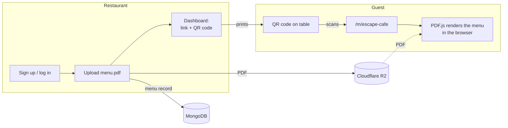
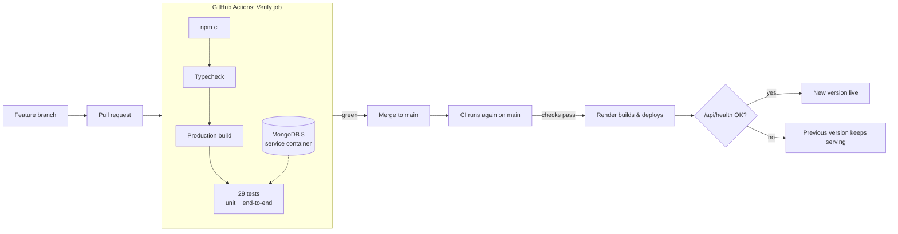

# MenuQR: restaurant menus as QR codes

[](https://github.com/suhanaayisha/menuqr-generator/actions/workflows/ci.yml)


**Live demo: [menuqr-hwlp.onrender.com](https://menuqr-hwlp.onrender.com)** (free hosting, so the first visit may take up to a minute while it wakes up)

MenuQR turns a restaurant's PDF menu into a mobile-friendly web page and a printable QR code. Restaurants sign up and upload their menu, then put the QR code on their tables. Guests scan it and the menu opens on their phone, with no app and no PDF viewer needed.

It's a full-stack **Next.js 16** app (React 19, App Router, Server Actions) written in TypeScript, backed by **MongoDB** and **Cloudflare R2**. Every change goes through a **GitHub Actions** pipeline that type-checks it, builds it for production and tests it end to end against a real database. Deployment to **Render** is defined in code and only releases commits that pass CI.

> The project began as the starter app from Brad Traversy's CI/CD Crash Course (a single Express endpoint). Everything after the baseline commit is my own work: the CI/CD pipeline, the product, accounts, storage, the React frontend and the test suite.

---

## Contents

- [Features](#features)
- [How it works](#how-it-works)
- [CI/CD pipeline](#cicd-pipeline)
- [Testing strategy](#testing-strategy)
- [Architecture](#architecture)
- [Security](#security)
- [Tech stack](#tech-stack)
- [Run it locally](#run-it-locally)
- [Configuration](#configuration)
- [Deploying to Render](#deploying-to-render)
- [Project history](#project-history)
- [Roadmap](#roadmap)

---

## Features

**For restaurants**
- Create an account with email, password and password confirmation.
- Upload a menu PDF (up to 25 MB) and get a unique, readable link such as `/m/escape-cafe`.
- Download a QR code as an SVG, which prints sharply at any size on table cards, posters or windows.
- Replace the PDF at any time. **The link and QR code never change**, so printed QR codes keep working.
- Manage several menus (lunch, dinner, drinks) from one dashboard.

**For guests**
- Scan the code and the menu opens straight away on any phone: no download, no app, no zooming into a PDF.
- The first page appears as soon as it's ready, while later pages keep loading.
- Menus are cached in the browser, so a 20 MB menu downloads once, not on every visit.

---

## How it works



1. **Upload:** the restaurant names the menu and uploads a PDF. The server checks it really is a PDF (by its contents, not its file name), stores it in Cloudflare R2, and saves the menu record in MongoDB with a unique link. If the name is taken, the link gets `-2`, `-3` and so on.
2. **Share:** the dashboard shows the link and a QR code that encodes it.
3. **View:** the guest's phone loads the menu page. A React component uses **PDF.js** to draw each page at the phone's screen width and pixel density, so the text is sharp.
4. **Update:** a new PDF replaces the old one behind the same link. The PDF's URL includes a version number, so browsers fetch the new menu straight away and cache it until the next change.

---

## CI/CD pipeline



### Continuous integration: [.github/workflows/ci.yml](.github/workflows/ci.yml)

Every pull request and every push to `main` runs the **Verify** job:

| Step | What it does | Why |
| --- | --- | --- |
| **MongoDB 8 service container** | Starts a real database next to the job and waits for its health check (`ping`) to pass | Tests run against the same database engine as production, not a mock |
| `npm ci` | Clean install, exactly matching `package-lock.json`, with the npm cache restored | Reproducible builds; no surprise dependency upgrades |
| `npm run typecheck` | Generates Next.js route types, then runs `tsc --noEmit` in strict mode | Catches type errors, including wrong route params, before anything runs |
| `npm run build` | Full Next.js production build (Turbopack) | Proves the app actually builds the way Render will build it |
| `npm test` | 16 business-logic tests, plus 13 end-to-end tests against the **production build** | Tests what users will actually get, not just the source code |

Pipeline settings:
- **One command everywhere:** CI runs `npm run verify`, the same command developers run locally. If it passes on your machine, it passes in CI.
- **Least privilege:** the workflow token has `contents: read` only.
- **Fails fast:** a 10-minute job timeout, plus a 15-second timeout on every test request, so a hung server fails the build in seconds instead of blocking CI.
- **Isolated test data:** tests read `TEST_MONGODB_URI`, never `MONGODB_URI`, and each test file creates and drops its own randomly named database. Tests can't touch real data, even on a developer laptop where `.env` points at production.

### Continuous deployment: [render.yaml](render.yaml)

The Render service is defined as code in a Render Blueprint:

- **Only deploys tested code:** with `autoDeployTrigger: checksPass`, Render deploys a commit to `main` only after its GitHub Actions checks pass. A failing test blocks the release automatically.
- **Zero-downtime health check:** Render sends traffic to a new version only after `/api/health` returns 200. If the new version fails to start, the previous one keeps serving.
- **Secrets stay out of git:** database and storage credentials are marked `sync: false`, so they're entered once in Render's dashboard and never committed. Locally they live in `.env`, which is gitignored.
- **Traceable releases:** `/api/version` returns the deployed git commit (from Render's `RENDER_GIT_COMMIT`), so you can always see exactly which commit is live.

### Proving the guardrails work

The pipeline was tested by breaking it on purpose. In [PR #2](https://github.com/suhanaayisha/menuqr-generator/pull/2) I pushed a deliberately failing test to confirm CI goes red and blocks the change, then reverted it in [PR #3](https://github.com/suhanaayisha/menuqr-generator/pull/3). Every change since has gone through a feature branch and a pull request.

---

## Testing strategy

**29 tests** using Node's built-in test runner (`node:test`). There are no mocks for the database: everything runs against real MongoDB.

### [test/lib.test.ts](test/lib.test.ts): business logic (16 tests)

Calls the framework-free code in `lib/` directly:
- **Config:** R2 settings are required when `STORAGE_DRIVER=r2`, unknown drivers are rejected, and the version falls back to the Render commit.
- **Accounts:** passwords are stored hashed (never in plain text), invalid emails, short passwords, mismatched confirmations and duplicate accounts are rejected, and login ignores email case.
- **Sessions:** sessions resolve to the right user, raw tokens are never stored, and deleted or expired sessions stop working.
- **Menus:** URL-safe unique links, PDF signature and size validation (rejected uploads leave no files behind), replace keeps the link and deletes the old file, delete cleans up storage, **one user cannot change or delete another user's menu**, and listing is per owner, newest first.

### [test/e2e.test.ts](test/e2e.test.ts): end to end (13 tests)

Starts the **real production build** (`next start`) on a free port, with a throwaway database and a temporary upload folder, then uses it like a browser:
- It submits the **actual Server Action forms** by reading the hidden action fields from the server-rendered HTML. Next.js forms work without JavaScript, so this tests the real sign-up, login, upload, replace and delete code paths.
- Full journey: sign up → upload → public menu page → exact PDF bytes and cache headers → QR code encoding the correct public URL → replace → delete → 404.
- Security: a copied session cookie stops working after logout, cross-site form posts are blocked, the dashboard requires login, and a `<script>` in a menu name is escaped.

### Manual browser checks

The PDF.js viewer and responsive layout were also checked in real Chrome (driven through the DevTools protocol) at desktop and phone sizes.

---

## Architecture

```text
app/                         Next.js App Router: UI and HTTP layer
├── (site)/                  Pages with the site header
│   ├── page.tsx             Landing page
│   ├── signup/ login/       Auth pages
│   └── dashboard/           Upload, replace, delete; QR downloads
├── m/[slug]/                Public guest pages (no site header)
│   ├── page.tsx             Menu page → <MenuViewer>
│   ├── menu.pdf/route.ts    Streams the PDF with cache headers
│   └── qr/route.ts          SVG QR code (?download=1 to save)
├── api/health, api/version  Health check and deployed version
├── actions.ts               Server Actions: thin wrappers around lib/
├── _components/             React: forms (pending states, inline errors), MenuViewer (PDF.js)
└── _lib/                    Session cookies, public URL from proxy headers
lib/                         Business logic: plain TypeScript, no Next.js imports
├── auth.ts                  Password hashing, sign-up/login rules, sessions
├── menus.ts                 Create / replace / delete / list, validation, links
├── db.ts                    MongoDB connection (pooled), types, indexes
├── storage.ts               FileStore interface → R2 | local disk | in-memory
└── config.ts                Environment parsing and validation
test/                        lib.test.ts, e2e.test.ts, shared helpers
```

Design decisions:
- **Business rules live in `lib/` and know nothing about Next.js.** Pages and Server Actions only read the request and call `lib/`. The rules are easy to test, and ownership checks can't be skipped by calling a different route.
- **Pluggable storage:** the `FileStore` interface has three implementations: Cloudflare R2 in production, a local folder in development and in-memory in tests. Switching is one environment variable.
- **Progressive enhancement:** forms are server-rendered and work without JavaScript. When it's available, React adds pending states ("Uploading…"), inline errors and instant checks such as file size and password confirmation.
- **PDF.js is loaded only on menu pages**, in the browser, so the dashboard and landing pages stay light.
- **One database connection pool** is reused across requests and hot reloads.

---

## Security

| Area | How it's handled |
| --- | --- |
| Passwords | scrypt with a random per-user salt; compared in constant time; never stored or logged in plain text |
| Sessions | 256-bit random tokens in `HttpOnly`, `SameSite=Lax` cookies (`Secure` over HTTPS). Only a SHA-256 hash is stored, and MongoDB deletes expired sessions automatically (TTL index). Logout deletes the session on the server. |
| CSRF | Next.js Server Actions reject requests whose `Origin` doesn't match the app's host; `SameSite=Lax` cookies add a second layer |
| Authorization | Every replace or delete looks up the menu by **ID and owner**, so changing someone else's menu returns "not found" |
| Uploads | Checked by the file's contents (`%PDF-` signature), not its name or MIME type; 25 MB limit enforced in the browser and on the server |
| XSS | React escapes all user content; a test checks that a `<script>` menu name is rendered harmlessly |
| Secrets | Only in `.env` (gitignored) or Render's dashboard; tests can't reach the real database |

---

## Tech stack

| Layer | Technology |
| --- | --- |
| Framework | Next.js 16 (App Router, Server Actions, Turbopack) |
| UI | React 19, plain CSS (forest green theme, responsive, WCAG AA contrast) |
| Language | TypeScript 7 (strict), Node.js 24 |
| Database | MongoDB 8: Atlas in production, Docker locally and in CI |
| File storage | Cloudflare R2 through the AWS S3 SDK |
| PDF rendering | PDF.js (in the browser) |
| QR codes | `qrcode` (SVG output) |
| Testing | `node:test` + `tsx`; end-to-end against the production build |
| CI | GitHub Actions with a MongoDB service container |
| CD / hosting | Render, defined as code in `render.yaml` |

---

## Run it locally

**Requirements:** Node.js 24, npm and Docker.

```bash
git clone https://github.com/suhanaayisha/menuqr-generator.git
cd menuqr-generator
npm ci
cp .env.example .env
npm run db:start        # MongoDB 8 in Docker on port 27017
npm run dev             # http://localhost:3000
```

Open [localhost:3000](http://localhost:3000), sign up and upload a PDF. With the default `.env`, PDFs are saved in `uploads/` and data goes to the local Docker MongoDB.

**Run the same checks as CI:**

```bash
npm run verify          # typecheck → production build → all 29 tests
```

### Scripts

| Command | What it does |
| --- | --- |
| `npm run dev` | Next.js dev server with hot reload |
| `npm run verify` | Typecheck, production build and tests: exactly what CI runs |
| `npm run typecheck` | Generates route types and runs `tsc --noEmit` |
| `npm run build` | Next.js production build |
| `npm start` | Serves the production build (uses `PORT`, default 3000) |
| `npm test` | Runs all tests (needs MongoDB and a build for the end-to-end tests) |
| `npm run db:start` / `npm run db:stop` | Starts or removes the local MongoDB container |

> **Tip:** if MongoDB is already using port 27017 for another project, run this project's container on another port and point `MONGODB_URI` and `TEST_MONGODB_URI` in `.env` at it.

---

## Configuration

All settings come from environment variables (`.env` locally, Render's dashboard in production). The app fails fast with a clear message if a required one is missing.

| Variable | Default | Purpose |
| --- | --- | --- |
| `MONGODB_URI` | `mongodb://127.0.0.1:27017` | MongoDB connection string (Atlas in production) |
| `MONGODB_DB` | `menus` | Database name |
| `TEST_MONGODB_URI` | `mongodb://127.0.0.1:27017` | MongoDB server for tests, kept separate so tests can never touch real data |
| `STORAGE_DRIVER` | `local` | `local` (folder on disk) or `r2` (Cloudflare R2) |
| `LOCAL_STORAGE_DIR` | `uploads` | Folder for `local` storage |
| `R2_ACCOUNT_ID`, `R2_ACCESS_KEY_ID`, `R2_SECRET_ACCESS_KEY`, `R2_BUCKET` | none | Required when `STORAGE_DRIVER=r2` |
| `PUBLIC_URL` | From request headers | Base URL encoded in QR codes; set it when you use a custom domain |
| `APP_VERSION` | Render's git commit, otherwise `development` | Returned by `/api/version` |
| `PORT` | `3000` | Port for `npm start` / `npm run dev` |

### HTTP endpoints

| Path | Access | Purpose |
| --- | --- | --- |
| `/` | Public | Landing page |
| `/signup`, `/login` | Public | Create an account, log in |
| `/dashboard` | Signed in | Upload, replace and delete menus; download QR codes |
| `/m/:slug` | Public | Menu page for guests |
| `/m/:slug/menu.pdf` | Public | The PDF (cached for a year when requested with its `?v=` version) |
| `/m/:slug/qr` | Public | SVG QR code; `?download=1` saves it as a file |
| `/api/health` | Public | `{"status":"ok"}` for Render's health check |
| `/api/version` | Public | `{"version":"<commit>"}` |

Sign-up, login, logout and menu changes are Server Actions in [app/actions.ts](app/actions.ts), not separate REST endpoints.

---

## Deploying to Render

Everything runs on free tiers: **Render** (web service), **MongoDB Atlas** (M0 cluster) and **Cloudflare R2** (10 GB).

1. **MongoDB Atlas:** create a free cluster and a database user. Under **Network Access**, allow `0.0.0.0/0`, because Render's free plan has no fixed IP addresses; the database is still protected by its username and password. Copy the connection string.
2. **Cloudflare R2:** create a bucket (for example `menuqr-menus`, which is the value in `render.yaml`), then create an **Account API token** with **Object Read & Write** access to that bucket only. Note the Account ID, Access Key ID and Secret Access Key. The bucket stays private, because the app serves the files itself.
3. **Render:** go to **New → Blueprint**, select this repository, and paste the four secrets when prompted: `MONGODB_URI`, `R2_ACCOUNT_ID`, `R2_ACCESS_KEY_ID` and `R2_SECRET_ACCESS_KEY`.
4. **Region:** change `region` in `render.yaml` to the one closest to your Atlas cluster.
5. **Custom domain (optional):** add it in Render and set `PUBLIC_URL` so QR codes use it.

From then on, merging a pull request into `main` triggers CI, and Render deploys automatically once CI passes.

The live instance runs at **[menuqr-hwlp.onrender.com](https://menuqr-hwlp.onrender.com)**.

> On Render's free plan the service sleeps after a period of inactivity, so the first request afterwards takes about a minute to start it. For a restaurant using it for real, the paid "Starter" plan keeps it always on.

---

## Project history

| Stage | Change |
| --- | --- |
| Baseline | Express + TypeScript starter with a health endpoint and one test |
| PR #1 | GitHub Actions CI: typecheck, test, build on every PR |
| PR #2–3 | Deliberately broke a test to prove CI blocks bad changes, then reverted |
| PR #4 | `/api/version` endpoint for traceable releases |
| PR #5–6 | Single restaurant menu page rendered from a PDF |
| Current branch | Multi-restaurant product: accounts, MongoDB, R2 storage, QR codes, rewrite to **Next.js 16 + React 19**, end-to-end tests against the production build, MongoDB in CI, Render Blueprint with CI-gated deploys |

---

## Roadmap

- Password reset by email
- Stripe subscriptions (free plan: one menu)
- Rate limiting on login and sign-up
- Menu view analytics for restaurants
- Custom QR code colors with a logo in the center
